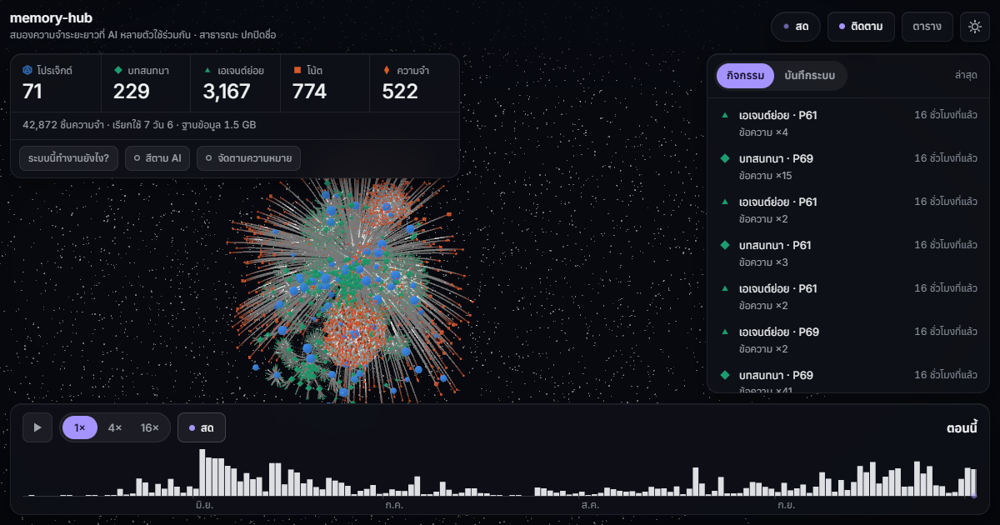
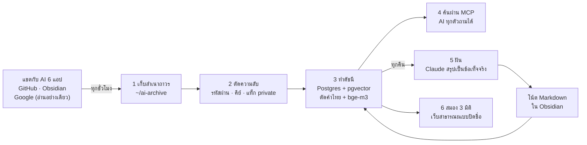

# memory-hub — สมุดความจำถาวรของ AI ทุกตัวในเครื่อง

**ปัญหา:** AI ทุกตัวขี้ลืม ปิดแชตแล้วเริ่มใหม่ก็ต้องเล่าเรื่องเดิมซ้ำ แถมแต่ละแอป (Claude, Codex, Gemini …) ต่างคนต่างจำ ไม่รู้ว่าอีกตัวคุยอะไรไว้

**memory-hub คือ "สมุดความจำกลาง" ที่อยู่ในคอมของเราเอง** มันเก็บแชตที่คุยกับ AI ไว้ถาวรในเครื่อง ตัดรหัสผ่านและกุญแจลับออกก่อนเข้าดัชนีค้นหา (สำเนาดิบในเครื่องยังเป็นข้อความเต็ม) แล้วให้ AI ทุกตัวค้นย้อนหลังได้ทั้งภาษาไทย อังกฤษ และโค้ด ทุกคืน Claude จะ "ฝัน" คืออ่านแชตของวันนั้นแล้วสรุปเป็นข้อเท็จจริงสั้น ๆ ทำให้ครั้งหน้าถามแค่ "เคยตกลงเรื่องนี้ไว้ว่าอะไร" ก็ได้คำตอบทันที

- ข้อมูลอยู่ในเครื่องเรา ไม่มีเซิร์ฟเวอร์กลาง ไม่ต้องสมัครบริการใหม่ (การ "ฝัน" ใช้ Claude Code ที่ล็อกอินบัญชี Claude ไว้แล้ว)
- ใช้บน Windows และไม่ใช่แอปกดติดตั้งทีเดียว: ต้องลง Node.js, Docker Desktop และ Ollama เอง แล้วพิมพ์คำสั่งตาม[ขั้นตอนติดตั้ง](#ติดตั้ง-windows)
- AI ที่ใช้ได้: Claude Code (ตัวหลัก), Codex, Gemini CLI, Antigravity, ZCode, LM Studio — Claude Desktop ค้นความจำได้ แต่แชตใน Claude Desktop เองยังไม่ถูกเก็บ
- ดูภาพ "สมอง 3 มิติ" ของความจำนี้ได้ที่ **https://memory-hub-brain.vercel.app** (เว็บสาธารณะ ปิดชื่อทุกอย่าง เห็นแค่รูปร่างและตัวเลข)



---

## สารบัญ

1. [ทำงานยังไง](#ทำงานยังไง)
2. [ฟีเจอร์ทั้งหมด](#ฟีเจอร์ทั้งหมด)
3. [ติดตั้ง (Windows)](#ติดตั้ง-windows)
4. [ใช้งาน](#ใช้งาน)
5. [ตั้งค่า (ตัวแปร env)](#ตั้งค่า-ตัวแปร-env)
6. [โครงสร้างโปรเจกต์และการทดสอบ](#โครงสร้างโปรเจกต์และการทดสอบ)
7. [ข้อจำกัด](#ข้อจำกัด)
8. [คำถามที่พบบ่อย](#คำถามที่พบบ่อย)

---

## ทำงานยังไง

ลองนึกถึงเลขาที่จดทุกอย่าง แล้วจัดแฟ้มให้ค้นง่าย:

1. **เก็บ** — ทุกชั่วโมงจะคัดลอกประวัติแชตของแอป AI ทุกตัวมาเก็บใน `~/ai-archive` แบบ "เพิ่มอย่างเดียว" ไม่ลบ ไม่เขียนทับ (แอปบางตัวลบแชตเก่าเองภายในไม่กี่สิบวัน แต่ที่นี่ยังอยู่)
2. **ตัดความลับ** — ก่อนเข้าดัชนี จะลบรหัสผ่าน คีย์ API โทเคน และข้อความในแท็ก `<private>…</private>` ออก
3. **ทำดัชนี** — หั่นแชตเป็นชิ้นเล็ก ตัดคำไทย ทำเวกเตอร์ความหมายด้วยโมเดล bge-m3 (รันในเครื่องผ่าน Ollama) เก็บใน Postgres
4. **ค้น** — AI ตัวไหนก็ถามได้ผ่าน MCP (มาตรฐานเชื่อมเครื่องมือของ AI) ได้คำตอบสั้น ๆ ไม่เกิน 8 ชิ้น อยากอ่านเต็มค่อยขอทีละชิ้น ประหยัด token
5. **ฝัน** — ตีสามครึ่งทุกคืน Claude อ่านแชตที่ยังไม่เคยสรุป แล้วเขียนเป็นโน้ต Markdown (ข้อเท็จจริง กฎ การตัดสินใจ) ลง Obsidian ใครแก้โน้ตเองได้ เครื่องจะไม่เขียนทับ
6. **โชว์สมอง** — สร้างกราฟ 3 มิติจากความจำ เวอร์ชันสาธารณะเปลี่ยนชื่อทุกอย่างเป็นรหัส (P1, V1 …) และตรวจซ้ำก่อนอัปโหลดทุกครั้ง



นอกจากนี้ ทุกครั้งที่เปิดแชตใหม่ในโปรเจกต์ไหน AI จะได้ "สรุปย่อ" ไม่เกิน 2,000 ตัวอักษรใส่มาให้อัตโนมัติ (SessionStart hook): กฎที่เราเคยสั่ง งานที่ค้างจากแอปอื่น สรุปแชตล่าสุดของโปรเจกต์นั้น และถ้าภายใน 48 ชม. มีแอปอื่นทำงานโปรเจกต์นี้อยู่ จะบอกว่า "ล่าสุด <แอป> ทำงานนี้ <กี่ชม.ก่อน>: <เรื่องอะไร>" ให้เอง ไม่ต้องสั่ง

---

## ฟีเจอร์ทั้งหมด

### แหล่งข้อมูล

| แหล่ง | อ่านจากไหน | หมายเหตุ |
|---|---|---|
| Claude Code | `~/.claude/projects/**/*.jsonl` | รวม subagent; hook ส่งเข้าดัชนีหลังจบแต่ละรอบ (ไม่เกินทุก 10 นาที) |
| Codex | `~/.codex/sessions/` + `archived_sessions/` | งาน `codex exec` ค้นได้ แต่ไม่เอาไปฝัน |
| Gemini CLI | `~/.gemini/tmp/<project>/chats/` | Gemini ลบแชตเก่าเอง ที่นี่จึงอาจเป็นสำเนาเดียวที่เหลือ |
| Antigravity | `~/.gemini/antigravity*/brain/*/…/transcript*.jsonl` | อ่านเฉพาะไฟล์ข้อความธรรมดา (`*.pb` เข้ารหัสอยู่) |
| ZCode | `~/.zcode/cli/db/db.sqlite` (เปิดแบบอ่านอย่างเดียว) | export เป็น JSONL ทีละ session |
| LM Studio | `~/.lmstudio/conversations/` | ไฟล์ถูกเขียนใหม่ทั้งไฟล์ → เก็บเวอร์ชันเก่าเป็น `.bak` |
| GitHub | `gh api` (อ่านอย่างเดียว token อยู่ใน `gh`) | การ์ด repo + README, commit ที่เราเขียน, issue/PR ที่เกี่ยวกับเรา — ค้นได้ ไม่เอาไปฝัน |
| Obsidian | vault ที่ตั้งใน `MEMHUB_VAULTS` | อ่านอย่างเดียว เก็บ `[[wikilink]]` เป็นเส้นเชื่อม |
| Gmail · Google Docs · Google Sheets | Google API สิทธิ์ `gmail.readonly` + `drive.readonly` เท่านั้น | **เห็นได้เฉพาะ Claude** ดู [Google](#google-gmail-docs-sheets--maps-timeline-ไม่บังคับ) |
| Google Maps Timeline | ไฟล์ export จากมือถือ | **เห็นได้เฉพาะ Claude** ชื่อสถานที่หาแบบออฟไลน์ด้วย GeoNames |

ทุกแอปใช้กฎเดียวกัน: ข้อมูลสดของแอปแค่ "อ่าน" ไม่เคยแก้, สำเนาใน `~/ai-archive/raw/<แอป>/` เพิ่มอย่างเดียว, "โปรเจกต์" = git root ของโฟลเดอร์ที่ทำงาน

### การค้น

- **ค้นแบบผสม 3 ทาง** แล้วรวมอันดับด้วย RRF (k=60 — สูตรรวมอันดับจากหลายรายการ ชิ้นที่ติดอันดับดีในหลายทางได้คะแนนสูง): คำ (ให้คะแนนคำหายากสูงกว่า), วลีไทย/ตัวเลขสั้น ๆ (เช่น `ภ.ง.ด.53`), และเวกเตอร์ความหมาย bge-m3
- **ตัดคำไทย** ด้วย `Intl.Segmenter` ของ Node (ICU) + แยกชื่อตัวแปรในโค้ด (`snake_case`, `camelCase` ฯลฯ); เลขไทยนับเป็นเลขอารบิก (`ภ.ง.ด.๕๓` = `ภ.ง.ด.53`)
- **จัดลำดับแบบสมองคน (ACT-R):** ความจำที่ถูกใช้บ่อยและเพิ่งใช้ ขึ้นก่อนนิดหน่อย
- **ลำดับชั้นความสำคัญ:** กฎ/ที่ปักหมุด/ที่สั่งจำ > ข้อเท็จจริงที่ Claude สรุป > แชตดิบ; ข้อเท็จจริงที่ล้าสมัยถูกกดลงและติดป้าย `OLD`
- **โปรเจกต์ปัจจุบันได้คะแนนเพิ่ม ×1.3** และไม่เกิน 3 ชิ้นต่อ session เพื่อให้ผลหลากหลาย
- **เข้าใจคำบอกเวลา:** "เมื่อวาน", "สัปดาห์ที่แล้ว", "เดือนสิงหา", "ปีที่แล้ว", "ครั้งล่าสุด", "last week" ฯลฯ = สิ่งที่เกิดในช่วงนั้น (หรือใหม่กว่า) ได้คะแนนเพิ่มนิดหน่อย ไม่ตัดอย่างอื่นทิ้ง
- **Ollama ล่มก็ยังค้นได้** — ตกไปใช้คำค้นอย่างเดียว (ติดป้าย keyword-only) ไม่ error
- **ประหยัด token:** ผลค้นไม่เกิน 8 ชิ้น เฉลี่ยชิ้นละ ~400 ตัวอักษร (อันดับ 1 ได้ถึง ~700, อันดับ 2 ~500, ที่เหลือสั้นลงให้รวมเท่าเดิม) และตัดช่วงที่มีคำค้นมากที่สุดมาแสดง เพื่อให้เห็นรายละเอียด (ตัวเลข/ชื่อไฟล์/ค่าตั้ง) ได้โดยไม่ต้อง `memory_get`; โหมด `detail:"brief"` บรรทัดเดียวต่อชิ้น; บอกล่วงหน้าว่าเปิดเต็มจะกินกี่ token (≈t)

### ความปลอดภัยและความเป็นส่วนตัว

- **อยู่ในเครื่องเท่านั้น:** Postgres ฟังที่ `127.0.0.1` เท่านั้น, embedding ทำในเครื่อง (ไม่ส่งไป API ภายนอก)
- **ตัดความลับก่อนเข้าดัชนี:** คีย์ของผู้ให้บริการหลายเจ้า (Anthropic, OpenAI-style `sk-`, GitHub, AWS, Google, Slack, Stripe …), JWT, private key, รหัสผ่านใน connection string, `password=…`, `รหัสผ่าน: …` และข้อความสุ่มยาว ๆ ที่น่าจะเป็นความลับ — ไฟล์ดิบใน archive ยังเก็บต้นฉบับ แต่ดัชนีเห็นแค่ฉบับที่ตัดแล้ว
- **ข้อมูลส่วนตัวจาก Google** ถูกตัดเพิ่ม: เลขบัตรเครดิต + CVV, เลขบัตรประชาชน, เลขบัญชี/พร้อมเพย์, เลขพาสปอร์ต, รหัส OTP, ลิงก์ล็อกอิน/รีเซ็ตรหัส และ query string ของทุก URL (เบอร์โทรไม่ถูกตัด)
- **`<private>…</private>`** ในแชต = ไม่เข้าดัชนีเลย
- **ลืมได้:** `forget --session` / `--project` ลบจากดัชนีถาวรและกันไม่ให้นำเข้าอีก; ข้อเท็จจริงและการ์ดที่ฝันจากแชตนั้นอย่างเดียวถูกลบตาม (ที่เราแก้เองไม่ถูกแตะ แต่ขึ้นรายการให้ตัดสินใจ) ลบไฟล์โน้ตข้อเท็จจริงใน Obsidian = เครื่องจะไม่สร้างกลับ ดู[ลบความจำยังไง?](#คำถามที่พบบ่อย)
- **ไม่เอาเข้าตั้งแต่แรก:** `MEMHUB_EXCLUDE_PROJECTS` สำหรับโฟลเดอร์ลูกค้า/งานลับ
- **ประตู Claude-only:** ข้อมูล Gmail/Docs/Sheets/Timeline ส่งผ่าน MCP ให้เฉพาะแอป Claude ที่ใช้ API ของ Anthropic โดยตรง ไม่โชว์ใน SessionStart ไม่เอาไปฝัน และแชต Claude ที่เคยเห็นข้อมูลนี้ก็ถูกซ่อนจากแอปอื่นทั้งแชต
- **โหมดเข้มงวด:** `MEMHUB_ANTHROPIC_ONLY=1` = ให้เฉพาะแอป Claude ที่คุยกับ Anthropic จริง (ถ้าตั้ง `ANTHROPIC_BASE_URL` ไปเจ้าอื่น ความจำจะปิด) — `ANTHROPIC_BASE_URL` ที่ชี้ไป `localhost` / `127.0.0.1` / `[::1]` นับเป็น Anthropic เพราะถือว่าเป็น proxy ของเราเอง ถ้า proxy นั้นส่งต่อไปเจ้าอื่น โหมดนี้กันไม่ได้
- **เว็บสาธารณะ** มีแค่รูปร่างกราฟ ตัวเลข เวลา และชื่อแอป AI; `assertAnonymous` ตรวจทุกครั้งก่อนอัปโหลด เจอชื่อโปรเจกต์/path/session ใด ๆ = ยกเลิก
- **ข้อความจาก AI อื่นเป็นแค่ "ข้อมูล" ไม่ใช่ "คำสั่ง":** งานส่งต่อข้ามแอปถูกติดป้ายนี้ และกรองแท็กที่ใช้หลอก AI ออก

### เครื่องมือ MCP 6 ตัว

| เครื่องมือ | ทำอะไร |
|---|---|
| `memory_search` | ค้นความจำ (ไทย/อังกฤษ/โค้ด) กรองตามโปรเจกต์หรือช่วงวันที่ (`since`/`until` เป็นวันตามเวลาไทย นับรวมวันสุดท้าย) ได้ ได้ไม่เกิน 8 ชิ้นพร้อม id |
| `memory_get` | เปิดเนื้อหาเต็มของชิ้นที่เลือก + บทสนทนารอบ ๆ หรือที่มาของข้อเท็จจริง |
| `memory_timeline` | ดูว่าเกิดอะไรก่อน/หลังชิ้นนั้น และแอปอื่นทำอะไรกับโปรเจกต์เดียวกันช่วงนั้น (≤1,500 ตัวอักษร) |
| `memory_related` | ตามเส้นเชื่อมแบบสมอง: wikilink, backlink, ที่ถูกใช้คู่กันบ่อย, ที่ความหมายคล้ายกัน |
| `memory_save` | "จำไว้นะ" — เขียนโน้ตลง vault ของ memory-hub ให้ทุกแอปเห็นในแชตถัดไป |
| `memory_handoff` | ส่งงานค้างข้ามแอป: `save` ตอนหยุด, `list` ดูงานค้าง, `claim` รับงาน (รับได้แอปเดียว), `done` ปิดงาน |

### ตัวเลขความเร็วและความแม่นจริง

| วัดอะไร | ผล | หมายเหตุ |
|---|---|---|
| ความเร็ว `search()` (ชุด benchmark 35,434 ชิ้น) | ผสม p50 **37.5 ms** / p95 54.8 ms · คำอย่างเดียว p50 15.3 ms | รวมเวลาทำเวกเตอร์คำถามแล้ว |
| ความเร็วใช้งานจริงผ่าน MCP (เครื่องผู้พัฒนา 24 ชม. ถึง 2026-10-03, ค้น 35 ครั้ง) | `memory_search` p50 ≈ 124 ms / p95 ≈ 266 ms · `memory_get` ≈ 4 ms | ตัวอย่างน้อย ตัวเลขแกว่งตามเครื่อง ดูของตัวเองด้วย `node src/cli.ts stats --latency` |
| LongMemEval_S (session recall) | R@5 **97.3%** / R@10 98.6% | วัด 74 จาก 500 ข้อ (ช่วงเชื่อมั่น 95%: 90.7–99.3) — **ระดับเดียวกับ**โปรเจกต์ดัง ไม่ใช่เหนือกว่า |
| LoCoMo (ครบ 1,986 ข้อ) | session R@5 **87.7%** / R@10 **93.9%** · ระดับ dialog R@5/10/25 = 60.5 / 69.5 / 78.1% | |

> อ่านตาราง: p50/p95 = เวลาที่ครึ่งหนึ่ง/95% ของการค้นเร็วกว่านี้ (ms = มิลลิวินาที) · R@5 = คำตอบที่ถูกอยู่ใน 5 อันดับแรก · session/dialog = นับเป็นทั้งแชต/ทีละข้อความ

ข้อควรรู้: วัดแค่ "หาเจอไหม" ไม่ได้วัดว่า AI ตอบถูก, ชุดข้อมูลเป็นภาษาอังกฤษล้วน (ยังไม่ได้วัดภาษาไทย), ตัวเลขของโปรเจกต์อื่นเป็นตัวเลขที่เขารายงานเอง วิธีวัดครบอยู่ใน [docs/benchmarks.md](docs/benchmarks.md)

---

## ติดตั้ง (Windows)

> ทำบน Windows 11 เป็นหลัก ตัวอย่างในหน้านี้วางโปรเจกต์ไว้ที่ `D:\memoryhub` — วางที่อื่นได้ แค่เปลี่ยน `D:/memoryhub` ในตัวอย่าง config ให้เป็น path ของเรา (สคริปต์ตั้งเวลาหาโฟลเดอร์ตัวเองได้ แต่เรียก `C:\Program Files\nodejs\node.exe` ตรง ๆ ถ้าติดตั้ง Node ไว้ที่อื่นให้แก้ใน `scripts\hourly.cmd` และ `scripts\nightly.cmd`)

### สิ่งที่ต้องมี

| โปรแกรม | ใช้ทำอะไร | จำเป็น? |
|---|---|---|
| [Node.js](https://nodejs.org) 24 ขึ้นไป | รันโค้ด `.ts` ได้ตรง ๆ ไม่ต้อง build | ต้องมี |
| [Git for Windows](https://git-scm.com/download/win) | `git clone` + เก็บประวัติ vault ที่ memory-hub เขียน | ต้องมี |
| [Docker Desktop](https://www.docker.com/products/docker-desktop/) | ฐานข้อมูล Postgres 18 + pgvector | ต้องมี |
| [Ollama](https://ollama.com) + โมเดล `bge-m3` | ทำเวกเตอร์ความหมาย (ไม่มีก็ค้นได้ แต่ค้นด้วยคำอย่างเดียว) | แนะนำ |
| Claude Code CLI ที่ล็อกอิน Anthropic แล้ว | "ฝัน" ทุกคืน | ถ้าอยากได้ข้อเท็จจริงสรุป |
| [GitHub CLI](https://cli.github.com) (`gh auth login`) | นำเข้า GitHub | ไม่บังคับ |
| Google Chrome | สคริปต์ตรวจเว็บ/ถ่ายภาพปก | ไม่บังคับ |
| Vercel CLI | เผยแพร่เว็บสมองสาธารณะ | ไม่บังคับ |

> เครื่อง: RAM แนะนำ 16 GB ขึ้นไป (Postgres ใน `compose.yml` จองหน่วยความจำราว 2–3 GB, `bge-m3` อีกราว 1–2 GB) · ดิสก์: เผื่อสำเนาดิบเท่ากับขนาดประวัติแชตทั้งหมด + ฐานข้อมูลราว 1/10 ของนั้น

### ขั้นตอน

```powershell
# 1) โหลดโค้ด
git clone https://github.com/jaturapornchai/mymemory01 D:\memoryhub
cd D:\memoryhub
npm install

# 2) สร้าง .env พร้อมรหัสผ่านสุ่ม (ไฟล์นี้ไม่ขึ้น git)
node src/cli.ts init

# 3) เปิดฐานข้อมูล (ฟังที่ 127.0.0.1:5441 เท่านั้น) แล้วสร้างตาราง
docker compose up -d
#    ครั้งแรกรอประมาณ 15-30 วินาทีให้ฐานข้อมูลตั้งตัวเสร็จ: docker compose logs pg ต้องขึ้น
#    "ready to accept connections" หลังบรรทัด "init process complete"
#    ถ้า migrate ขึ้น ECONNRESET / ECONNREFUSED แปลว่ายังไม่พร้อม รอสักครู่แล้วรันใหม่
node src/cli.ts migrate

# 4) โหลดโมเดลทำเวกเตอร์
ollama pull bge-m3

# 5) นำเข้าครั้งแรก: เก็บ + ทำดัชนี + เวกเตอร์
#    ครั้งแรกนานตามจำนวนแชต: ทำเวกเตอร์ราว 10 ชิ้น/วินาที คนใช้ AI หนัก ๆ อาจเกิน 1 ชั่วโมง
#    (ระหว่างทำเวกเตอร์ ค้นด้วยคำได้แล้ว)
node src/cli.ts sync

# 6) ลองค้น
node src/cli.ts search "ภ.ง.ด.53"
```

ตั้งค่าอื่นเพิ่มใน `.env` ได้ (ดู [ตั้งค่า](#ตั้งค่า-ตัวแปร-env) และตัวอย่างใน [`.env.example`](.env.example)) เช่น vault ของ Obsidian ที่อยากให้ค้นได้ (ไม่ตั้ง = ไม่อ่าน vault ไหนเลย นอกจาก vault ของ memory-hub เอง):

```ini
MEMHUB_VAULTS=D:/obsidian-vault/ตัวอย่าง
MEMHUB_MEMORY_VAULT=D:/obsidian-vault/memory-hub
```

> - **ไม่มีไดรฟ์ `D:`** → ต้องตั้ง `MEMHUB_MEMORY_VAULT` เป็นโฟลเดอร์ที่มีจริง ไม่อย่างนั้น `memory_save` และการฝันจะเขียนโน้ตไม่ได้
> - **ลง Claude Code ด้วยตัวติดตั้งแบบ native (ไม่ใช่ `npm i -g`)** → ตั้ง `MEMHUB_CLAUDE_BIN` เป็น path ที่ได้จาก `where claude` ไม่อย่างนั้นการฝันจะหาโปรแกรมไม่เจอ
> - อย่าคัดลอก `.env.example` ทับ `.env` — ให้ `init` สร้าง `.env` แล้วค่อยเพิ่มเฉพาะบรรทัดที่ต้องการ

### เชื่อมแอป AI

ทุกแอปใช้เซิร์ฟเวอร์ MCP ตัวเดียวกัน: `node D:/memoryhub/src/mcp.ts` (แบบ stdio) แอปเดสก์ท็อปบางตัวหา `node` ใน PATH ไม่เจอ จึงใช้ path เต็มของ `node.exe`

**Claude Code** — MCP + hook 3 ตัว

```powershell
claude mcp add --scope user memory-hub -- node D:/memoryhub/src/mcp.ts
```

แล้วเพิ่มใน `~/.claude/settings.json` (ส่วน `hooks`):

```json
{
  "hooks": {
    "SessionStart": [{ "hooks": [{ "type": "command", "command": "node D:/memoryhub/src/session-start.ts", "timeout": 15 }] }],
    "Stop":         [{ "hooks": [{ "type": "command", "command": "node D:/memoryhub/src/hook.ts", "timeout": 15 }] }],
    "SessionEnd":   [{ "hooks": [{ "type": "command", "command": "node D:/memoryhub/src/hook.ts", "timeout": 15 }] }]
  }
}
```

**Claude Desktop** — `%APPDATA%\Claude\claude_desktop_config.json` แล้วรีสตาร์ตแอป

```json
{ "mcpServers": { "memory-hub": { "command": "C:\\Program Files\\nodejs\\node.exe", "args": ["D:/memoryhub/src/mcp.ts"] } } }
```

**Codex** — `~/.codex/config.toml`

```toml
[mcp_servers.memory-hub]
command = 'C:\Program Files\nodejs\node.exe'
args = ["D:/memoryhub/src/mcp.ts"]
startup_timeout_sec = 30
tool_timeout_sec = 60
```

และ hook ใน `~/.codex/hooks.json`:

```json
{ "hooks": { "SessionStart": [{ "hooks": [{ "type": "command", "command": "node D:/memoryhub/src/session-start.ts --app codex", "timeout": 15 }] }] } }
```

> Codex จะข้าม hook ใหม่หรือที่แก้ไขจนกว่าจะกดเชื่อถือ: เปิด Codex → `/hooks` → trust `memory-hub` (ต้องทำใหม่ทุกครั้งที่แก้ไฟล์)

**Gemini CLI** — `~/.gemini/settings.json`

```json
{
  "mcpServers": { "memory-hub": { "command": "C:\\Program Files\\nodejs\\node.exe", "args": ["D:/memoryhub/src/mcp.ts"], "timeout": 30000 } },
  "hooks": { "SessionStart": [{ "hooks": [{ "name": "memory-hub", "type": "command", "command": "node D:/memoryhub/src/session-start.ts --app gemini", "timeout": 15000 }] }] }
}
```

> Gemini CLI รัน hook และ MCP เฉพาะในโฟลเดอร์ที่เชื่อถือแล้ว (`/permissions`) — โฟลเดอร์ที่ยังไม่เชื่อถือ `gemini mcp list` จะขึ้น memory-hub ว่า Disabled

**Antigravity** — `~/.gemini/antigravity/mcp_config.json` (ไม่มี hook เริ่มแชต จึงอาศัยคำแนะนำในตัวเซิร์ฟเวอร์)

```json
{ "mcpServers": { "memory-hub": { "command": "C:\\Program Files\\nodejs\\node.exe", "args": ["D:/memoryhub/src/mcp.ts"] } } }
```

**ZCode** — `~/.zcode/cli/config.json`

```json
{
  "mcp": { "servers": { "memory-hub": { "type": "stdio", "command": "C:\\Program Files\\nodejs\\node.exe", "args": ["D:/memoryhub/src/mcp.ts"], "enabled": true, "timeoutMs": 60000 } } },
  "hooks": { "enabled": true, "events": { "SessionStart": [{ "matcher": "startup|clear|compact",
    "hooks": [{ "type": "process", "command": "node", "args": ["D:/memoryhub/src/session-start.ts", "--app", "zcode"], "timeoutMs": 15000 }] }] } }
}
```

**LM Studio** — `~/.lmstudio/mcp.json` (ไม่มี hook)

```json
{ "mcpServers": { "memory-hub": { "command": "C:\\Program Files\\nodejs\\node.exe", "args": ["D:/memoryhub/src/mcp.ts"] } } }
```

> Antigravity และ LM Studio มักเปิดเซิร์ฟเวอร์นอกโฟลเดอร์โปรเจกต์ เซิร์ฟเวอร์จะบอกให้ส่ง `project=<path เต็มของ workspace>` ตอนใช้ `memory_handoff` ไม่อย่างนั้นจะเห็นแค่งานส่งต่อแบบ global

ตรวจว่าเซิร์ฟเวอร์ใช้ได้โดยไม่ต้องเปิดแอป: `node scripts/mcp-smoke.ts "คำค้น"`

### งานตั้งเวลา (Task Scheduler)

```powershell
# ติดตั้ง: \memory-hub\hourly (ทุกชั่วโมง นาทีที่ 17) และ \memory-hub\nightly (ตี 3:30)
# (รันในโฟลเดอร์โปรเจกต์ งานที่ลงทะเบียนจะชี้ไปที่โฟลเดอร์นี้)
powershell -ExecutionPolicy Bypass -File scripts\install-tasks.ps1
# ถอน
powershell -ExecutionPolicy Bypass -File scripts\install-tasks.ps1 -Remove
```

- **hourly** = `sync` แล้ว `publish` · **nightly** = `dream` → `dream --consolidate` → `daily` → `lint` → `publish` (แต่ละขั้นล้มได้โดยไม่ทำให้ขั้นถัดไปไม่รัน)
- รันในชื่อผู้ใช้ปัจจุบัน เฉพาะตอนล็อกอินอยู่ ไม่ต้องเก็บรหัสผ่าน ไม่มีหน้าต่างเด้ง (ผ่าน `scripts\hidden.vbs`)
- log อยู่ที่ `logs\hourly.log` และ `logs\nightly.log`
- `publish` ไม่ทำอะไรจนกว่าจะผูกโฟลเดอร์ `deploy\memory-hub-brain` กับโปรเจกต์ Vercel **ของเราเอง** (ยังไม่ผูก = log เขียน `publish: skipped` แล้วข้าม) — เว็บ memory-hub-brain.vercel.app เป็นของผู้เขียน ไม่ใช่ของคนที่ clone ไป
- อยากมีเว็บสมองของตัวเอง (ต้องมี Vercel CLI + Chrome สำหรับภาพปก): `cd web; npm install; cd ..` → `mkdir deploy\memory-hub-brain` → `cd deploy\memory-hub-brain; vercel link; cd ..\..` (สร้างโปรเจกต์ใหม่ในบัญชีเรา) → `node src/cli.ts publish --build`

### Google: Gmail, Docs, Sheets + Maps Timeline (ไม่บังคับ)

ทั้งหมดนี้ **อ่านอย่างเดียว** และ **เห็นได้เฉพาะ Claude** — ขั้นตอนละเอียดทีละหน้าจอ (ภาษาไทย) และรายละเอียดเชิงเทคนิคอยู่ใน [docs/google.md](docs/google.md)

**Gmail / Docs / Sheets**

1. ใน Google Cloud Console สร้าง project → เปิด Gmail API, Google Drive API, Google Sheets API
2. ตั้ง OAuth consent screen แบบ External ใส่ scope แค่ 2 ตัว: `gmail.readonly` และ `drive.readonly` (ถ้า token มี scope เกิน โปรแกรมจะปฏิเสธ ไม่เก็บอะไรเลย)
3. สร้าง OAuth client ชนิด **Desktop app** → ดาวน์โหลดไฟล์ `client_secret_….json` ไปไว้ที่ `%USERPROFILE%\.memory-hub\google\` (ห้ามวางในโฟลเดอร์โปรเจกต์)
4. `node src/cli.ts google login` → เบราว์เซอร์เปิดให้กดอนุญาต; refresh token ถูกเข้ารหัสด้วย Windows DPAPI เก็บเป็น `token.dpapi`
5. `node src/cli.ts google status --dry` ดูจำนวนที่จะดึงก่อน → รอรอบ hourly หรือรัน `node src/cli.ts sync`

เมลที่ดึง: ติดดาว / สำคัญ / ที่เราส่ง (ไม่เอาโปรโมชัน โซเชียล OTP และเมลรีเซ็ตรหัสผ่าน) · Docs/Sheets ที่เราเป็นเจ้าของ + ไฟล์ที่คนอื่นแชร์มาและเราเปิดภายใน 12 เดือน · Sheets เก็บแค่ชื่อแท็บและหัวตาราง ยกเว้นไฟล์ที่ใส่ไว้ใน `sheets-allow.txt` · ไม่อยากให้จำ: ติด label `no-memory` ใน Gmail หรือใส่คำ `no-memory` ในชื่อไฟล์ Drive · ยกเลิกสิทธิ์: `node src/cli.ts google revoke`

**Google Maps Timeline**

1. export Timeline จากแอป Google Maps บนมือถือ (รองรับรูปแบบไฟล์ของ iOS: JSON array ของ visit/activity — **ไฟล์จาก Android** ที่เป็น object มี `semanticSegments` **ยังไม่รองรับ** จะถูกนับเป็น invalid)
2. วางไฟล์ใน `~/ai-archive/inbox/google-timeline/` (หรือระบุ path ใน `MEMHUB_TIMELINE_FILES`) — ไฟล์ต้นฉบับถูกอ่านอย่างเดียว
3. ดาวน์โหลดไฟล์ GeoNames 4 ไฟล์ จาก https://download.geonames.org/export/dump/ ไว้ใน `~/ai-archive/ref/geonames/`: `TH.txt` (จาก `TH.zip`), `cities500.txt` (จาก `cities500.zip`), `admin1CodesASCII.txt`, `admin2Codes.txt` — ข้อมูล GeoNames ใช้สัญญาอนุญาต CC-BY 4.0 (ต้องมีครบก่อน ไม่อย่างนั้นการอ่าน Timeline จะล้มเพราะหาไฟล์ไม่เจอ)
4. รอบ `sync` ถัดไปจะสรุปเป็นทริป/เดือน/วัน พร้อมชื่อประเทศ จังหวัด อำเภอ (ไทย+อังกฤษ) — ไม่มีพิกัดในดัชนี บ้านถูกเขียนว่า "บ้าน" เฉย ๆ และเส้นทาง GPS ละเอียดอยู่แค่ในไฟล์ดิบ
5. ในการตั้งค่า Timeline ของแอป Google Maps บนมือถือ ตั้ง "ลบอัตโนมัติ" (auto-delete) เป็น **ไม่ลบอัตโนมัติ** — ตอนเปิด Timeline ครั้งแรก Google ตั้งให้ลบข้อมูลที่เก่ากว่า 3 เดือนเอง และข้อมูลอยู่บนมือถือเครื่องเดียว
6. export ใหม่ **ทุกเดือน** แล้ววางไฟล์ใน inbox เดิม — ถ้าข้อมูลล่าสุดเก่ากว่า 30 วัน `google status` และ `logs\hourly.log` จะเตือน (บอกแค่อายุเป็นวัน ไม่มีชื่อสถานที่หรือวันที่)

---

## ใช้งาน

### คุยกับ AI ได้เลย (ตัวอย่าง)

| พิมพ์ว่า | AI จะ |
|---|---|
| "จำไว้ว่า โปรเจกต์ A ใช้ Postgres พอร์ต 5432 เท่านั้น" | `memory_save` เป็นกฎของโปรเจกต์ |
| "จำไว้ทุกโปรเจกต์: ตอบเป็นภาษาไทยเสมอ" | `memory_save` แบบ global |
| "เมื่อวานทำอะไรกับโปรเจกต์ A ไปบ้าง" | `memory_search` กรองโปรเจกต์ + วันที่ แล้วใช้ `memory_timeline` ไล่ดู |
| "วันที่ 1-15 ก.ย. ทำอะไรไปบ้าง" | `memory_search` ด้วย `since: 2026-09-01, until: 2026-09-15` |
| "ครั้งก่อนแก้บั๊กหน้า login ยังไง" | `memory_search` → เปิดเต็มด้วย `memory_get` ถ้าจำเป็น |
| "ปีนี้ไปต่างจังหวัดที่ไหนมาบ้าง" | ค้น Google Maps Timeline (เฉพาะ Claude) |
| "หาเมลใบเสนอราคาล่าสุด" | ค้น Gmail (เฉพาะ Claude) |
| "หยุดตรงนี้ก่อน เดี๋ยวไปทำต่อใน Codex" | `memory_handoff save` |
| (เปิด Codex ในโปรเจกต์เดิม) "มีงานค้างไหม" | `memory_handoff list` → `claim` |

ไม่อยากให้จำเรื่องไหน ให้ครอบด้วย `<private>…</private>`

### คำสั่ง CLI (`node src/cli.ts <คำสั่ง>`)

| คำสั่ง | ทำอะไร |
|---|---|
| `init` | สร้าง `.env` พร้อมรหัสผ่านสุ่ม (ถ้ามีอยู่แล้วจะไม่แตะ) |
| `migrate` | สร้าง/อัปเดตตารางจาก `sql/schema.sql` |
| `sync [--google-full]` | ที่ hourly รัน: คัดลอกเข้า archive + ทำดัชนี + vault + เวกเตอร์ (`--google-full` = ดึง Google ทั้งหมดรอบนี้) |
| `import [--force] [file]` | ทำดัชนีจาก archive อย่างเดียว; `--force` = ใช้กฎตัดความลับ/โปรเจกต์ใหม่กับข้อมูลเดิมทั้งหมด |
| `ingest <live.jsonl>` | นำเข้าแชต Claude 1 ไฟล์ (hook เรียกเอง) |
| `embed` | ทำเวกเตอร์ให้ชิ้นที่ยังไม่มี (เช่น หลังเปลี่ยนโมเดล) |
| `retokenize` | ตัดคำใหม่ทั้งหมดหลังแก้ตัวตัดคำ (เก็บเวกเตอร์เดิม; เขียนทับเฉพาะแถวที่ token เปลี่ยน รันซ้ำได้) |
| `search [--since วันที่] [--until วันที่] <คำค้น>` | ค้นแบบเดียวกับที่ AI ได้ พร้อมเวลาที่ใช้ (วันที่แบบ ISO เช่น 2026-09-15) |
| `stats` | จำนวน source / turn / chunk และขนาดฐานข้อมูล |
| `stats --latency` | ความเร็วการเรียก MCP จริง 1 และ 7 วันล่าสุด: p50/p95 ต่อเครื่องมือและต่อแอป + % ที่ค้นแบบคำอย่างเดียว |
| `stats --injected [n]` | n ครั้งล่าสุด (ปกติ 10) ที่ SessionStart ใส่สรุปให้แชตใหม่: แอป โปรเจกต์ จำนวนตัวอักษร และ id ที่ใส่ (เก็บแค่ id ไม่เก็บข้อความ เปิดดูด้วย `memory_get`) |
| `daily [YYYY-MM-DD] [--out dir]` | บันทึกประจำวันลง vault memory-hub `daily/YYYY-MM-DD.md` (ไม่ใส่วัน = เมื่อวาน ตามเวลาไทย): ต่อโปรเจกต์ แอปไหนกี่ session เวลาแรก–สุดท้าย เรื่องที่ทำ commit/issue ความจำใหม่/ถูกแทนที่ งานส่งต่อ — ไม่ใช้ LLM, ไม่มีข้อมูล Google/สถานที่, โน้ตที่เราแก้แล้วจะไม่ถูกเขียนทับ, ค้นได้แต่อันดับต่ำกว่าแชต; `--out` = เขียนไฟล์ตัวอย่างไว้ที่อื่น ไม่แตะ vault |
| `index-vault [vault]` | ทำดัชนี Obsidian ใหม่ (ไม่ระบุ = ทุก vault) |
| `forget --session <id>` / `forget --project <path>` | ลบออกจากดัชนีถาวรและกันนำเข้าซ้ำ (ไฟล์ดิบใน archive ไม่ถูกลบ) พร้อมลบข้อเท็จจริง/การ์ดที่ฝันจากแชตนั้นอย่างเดียว แล้วพิมพ์รายการที่ลบ |
| `dream [--limit n] [--runner claude\|files] [--run id] [--force]` | ฝัน: สรุปแชตใหม่เป็นการ์ด + ข้อเท็จจริง (ปกติไม่เกิน 25 session ต่อรอบ ใหม่สุดก่อน) |
| `dream --consolidate` | งานกลางคืนที่ไม่ใช้ LLM: อนุมัติ, เส้นเชื่อมใช้คู่กัน, โน้ตศูนย์กลาง |
| `lint [--dry]` | ตรวจสุขภาพความจำ (รายงานอย่างเดียว ไม่ใช้ LLM): ข้อเท็จจริงเลยวันหมดอายุ, คู่ที่อาจซ้ำ, ข้อเท็จจริงที่แชตต้นทางหายหมด, ลิงก์เสีย, งานส่งต่อค้าง → `hubs/_lint.md` ใน vault (`--dry` = พิมพ์ออกจอ ไม่เขียน) |
| `handoff [list\|show <id>\|done <id>]` | ดู/ปิดงานส่งต่อข้ามแอป |
| `vault init\|log [-n N]\|diff [rev] [--full]\|undo <rev> [--force]` | ประวัติ git ในเครื่องของ vault memory-hub: ดูว่าฝันแก้อะไร และย้อนได้ |
| `google login\|status [--dry]\|revoke` | ตั้งค่า/ตรวจ/ยกเลิกสิทธิ์ Google |
| `brain [--public] [--out file] [--rebake]` | ส่งออกกราฟสมองเป็น JSON (`--rebake` = จัดตำแหน่งใหม่หมด) |
| `brain-serve [--port n]` | เปิดสมองแบบมีชื่อจริงดูในเครื่อง http://127.0.0.1:5442 (ไม่เปิดสู่ภายนอก) — ต้อง build เว็บก่อน: `cd web; npm install; npm run build; cd ..` |
| `publish [--build] [--force]` | ส่งสมองแบบปิดชื่อขึ้น Vercel (ข้ามถ้ายังไม่ได้ `vercel link` หรือกราฟไม่เปลี่ยน; ต้องผ่าน `assertAnonymous`) |

สคริปต์เสริม:

| คำสั่ง | ทำอะไร |
|---|---|
| `node scripts/mcp-smoke.ts "คำค้น"` | เปิดเซิร์ฟเวอร์ MCP แบบที่แอปเปิดจริง แล้วลองค้น |
| `node scripts/redact-scan.ts <dir>` | ลองดูว่าตัวตัดความลับจะตัดอะไร (ไม่เขียนอะไร) |
| `node scripts/eval.ts` | วัด recall/MRR กับชุดคำถามของตัวเองใน `eval/questions.json` (ไฟล์นี้ไม่อยู่ใน git) |
| `npm run bench` | benchmark สาธารณะ LongMemEval_S + LoCoMo (ต้องโหลด dataset เอง ดู docs/benchmarks.md) |
| `node scripts/dream-files.ts unpack\|answer …` | ตอบคำขอ "ฝัน" ด้วยมือ/ด้วย Claude ในแชต เมื่อ `claude -p` ใช้ไม่ได้ (`dream --runner files`) |

### ประวัติ vault และการย้อน

vault ที่ memory-hub เขียน (`MEMHUB_MEMORY_VAULT`) เป็น git ในเครื่อง **ไม่มี remote ไม่เคย push** ทุกครั้งที่ฝันหรือ `memory_save` = 1 commit และสิ่งที่เราแก้เองใน Obsidian จะถูก commit แยกก่อนเสมอ (`ลุงจืด แก้เอง (snapshot)`; "ลุงจืด" คือชื่อผู้ใช้ที่ระบบเรียก ดูหัวข้อข้อจำกัด)

```powershell
node src/cli.ts vault log            # ดูประวัติ
node src/cli.ts vault diff           # ฝันครั้งล่าสุดแก้โน้ตอะไรบ้าง
node src/cli.ts vault undo <rev>     # ย้อน แล้วทำดัชนีใหม่ให้เอง
```

---

## ตั้งค่า (ตัวแปร env)

ใส่ใน `.env` ที่โฟลเดอร์โปรเจกต์ (โหลดอัตโนมัติ) หรือเป็น environment variable

**ฐานข้อมูลและเวกเตอร์**

| ตัวแปร | ค่าเริ่มต้น | ความหมาย |
|---|---|---|
| `MEMHUB_PG_PORT` | `5441` (จาก `init`) | พอร์ต Postgres บน 127.0.0.1 |
| `POSTGRES_PASSWORD`, `MEMHUB_RW_PASSWORD`, `MEMHUB_RO_PASSWORD` | สุ่มโดย `init` | `rw` = นำเข้า/ฝัน, `ro` = MCP (อ่าน + บันทึกการใช้งาน) |
| `OLLAMA_URL` | `http://127.0.0.1:11434` | ที่อยู่ Ollama |
| `MEMHUB_EMBED_MODEL` | `bge-m3` | เปลี่ยนแล้วต้องรัน `embed` ใหม่ทั้งหมด |
| `MEMHUB_EMBED_RATE` | `10` | จำนวนชิ้นต่อวินาทีตอนทำเวกเตอร์ (สูงเกินไปพอร์ตเครื่องหมด) |

**แหล่งข้อมูล**

| ตัวแปร | ค่าเริ่มต้น | ความหมาย |
|---|---|---|
| `MEMHUB_LIVE_DIR` | `~/.claude/projects` | แชต Claude Code ตัวจริง (อ่านอย่างเดียว) |
| `MEMHUB_ARCHIVE_DIR` | `~/ai-archive/raw/claude/projects` | สำเนาถาวรของแชต Claude |
| `MEMHUB_ARCHIVE_ROOT` | `~/ai-archive/raw` | สำเนาของแอปอื่น (`<root>/<แอป>`) |
| `MEMHUB_CODEX_HOME` / `MEMHUB_GEMINI_HOME` / `MEMHUB_ANTIGRAVITY_HOME` / `MEMHUB_ZCODE_HOME` / `MEMHUB_LMSTUDIO_HOME` | `~/.codex` / `~/.gemini` / `~/.gemini` / `~/.zcode` / `~/.lmstudio` | โฟลเดอร์ข้อมูลของแต่ละแอป |
| `MEMHUB_EXCLUDE_PROJECTS` | — | path โปรเจกต์ที่ห้ามเข้าดัชนี คั่นด้วย `,` เช่น `d:/clientx` |
| `MEMHUB_VAULTS` | — | vault Obsidian ที่ให้อ่าน คั่นด้วย `,` |
| `MEMHUB_MEMORY_VAULT` | `D:/obsidian-vault/memory-hub` | vault ที่ฝัน/`memory_save` เขียนลง |
| `MEMHUB_GOOGLE_DIR` | `~/.memory-hub/google` | ไฟล์ OAuth client, `token.dpapi`, `sheets-allow.txt` |
| `MEMHUB_GOOGLE_FULL` | — | `1` = ดึง Google เต็มรอบ (เหมือน `sync --google-full`) |
| `MEMHUB_TIMELINE_FILES` | — | ไฟล์ Timeline เพิ่มเติม คั่นด้วย `;` |
| `MEMHUB_GEONAMES_DIR` | `~/ai-archive/ref/geonames` | ไฟล์ GeoNames สำหรับชื่อสถานที่ |

**ฝัน**

| ตัวแปร | ค่าเริ่มต้น | ความหมาย |
|---|---|---|
| `MEMHUB_DREAM_MODEL` | `sonnet` | โมเดล Claude ที่ใช้ฝัน |
| `MEMHUB_CLAUDE_BIN` | `%APPDATA%\npm\node_modules\@anthropic-ai\claude-code\bin\claude.exe` | ตัว Claude CLI ที่เรียก `claude -p` |
| `MEMHUB_DREAM_RUNS` | `~/ai-archive/raw/memhub-dream` | บันทึกผลการฝันแต่ละรอบ |

**การค้นและจัดลำดับ** (ค่าที่จูนแล้ว ปกติไม่ต้องแก้)

| ตัวแปร | ค่าเริ่มต้น | ความหมาย |
|---|---|---|
| `MEMHUB_RANK_BETA` | `0.05` | น้ำหนักของ "ใช้บ่อย/เพิ่งใช้" |
| `MEMHUB_RANK_TIER` | `0.1` | ขั้นของลำดับชั้นความสำคัญ (`0` = ปิด) |
| `MEMHUB_RANK_SUPERSEDED` | `0.5` | ตัวคูณข้อเท็จจริงที่ล้าสมัย |
| `MEMHUB_RANK_SLOT`, `MEMHUB_RANK_SLOT_RATIO` | `2`, `0.5` | ดันข้อเท็จจริงที่ดีที่สุดขึ้นอันดับ 2 ถ้าคะแนนถึงครึ่งหนึ่งของอันดับ 1 |
| `MEMHUB_RANK_FOLD_DUP` | `0.5` | พับแชตต้นทางไว้ใต้ข้อเท็จจริงเมื่อเนื้อหาซ้ำกันเกินสัดส่วนนี้ |
| `MEMHUB_RANK_DAILY` | `-1` | ชั้นความสำคัญของบันทึกประจำวัน (`daily/`) — ต่ำกว่าแชตที่มันสรุป จะได้ไม่แย่งที่ในผลค้น |

**ความเป็นส่วนตัวและอื่น ๆ**

| ตัวแปร | ค่าเริ่มต้น | ความหมาย |
|---|---|---|
| `MEMHUB_ANTHROPIC_ONLY` | — | `1` = ให้ความจำเฉพาะแอป Claude ที่ใช้ backend ของ Anthropic |
| `MEMHUB_ALLOW_BACKEND` | — | host ที่ยอมเพิ่ม (ใช้คู่กับ `MEMHUB_ANTHROPIC_ONLY=1`) |
| `MEMHUB_PRIVATE_SOURCES` | — | `0` = ซ่อนข้อมูล Google จากทุกแอป รวม Claude |
| `MEMHUB_PUBLIC_SALT` | สุ่มแล้วเขียนเพิ่มใน `.env` เอง | เกลือสำหรับรหัสโหนดในเว็บสาธารณะ — ห้ามเผยแพร่ |
| `MEMHUB_HANDOFF_DAYS` | `7` | งานส่งต่อที่ไม่มีใครรับ หมดอายุหลังกี่วัน |
| `ANTHROPIC_BASE_URL` | (ของ Claude Code) | ถ้าชี้ไปที่อื่นที่ไม่ใช่ api.anthropic.com ข้อมูล Google จะถูกซ่อน |
| `MEMORY_HUB_INTERNAL` | — | ตั้งโดยงานเบื้องหลังของเราเอง: hook ไม่ทำงาน และไม่นับเป็นการใช้งาน |
| `NEXT_PUBLIC_DATA_URL` | ว่าง (โหลดจากเว็บเดียวกัน) | ที่อยู่ `graph.json` ของเว็บสมอง (ตอน build `web/`) |

สำหรับทดสอบเท่านั้น: `MEMHUB_PG_SCHEMA`, `MEMHUB_GITHUB_FAKE`, `MEMHUB_GITHUB_CLONES`, `MEMHUB_GOOGLE_FAKE`, `MEMHUB_NO_REINDEX`, และ `EVAL_*` ของ `scripts/eval.ts`

---

## โครงสร้างโปรเจกต์และการทดสอบ

```
src/
  cli.ts            คำสั่งทั้งหมด (node src/cli.ts …)
  mcp.ts            เซิร์ฟเวอร์ MCP (stdio) 6 เครื่องมือ
  session-start.ts  hook เริ่มแชต: ใส่สรุป ≤2,000 ตัวอักษร
  hook.ts           hook Stop/SessionEnd ของ Claude Code: สั่งนำเข้าเบื้องหลัง
  importer.ts       เก็บสำเนา + ทำดัชนี + forget
  claude.ts         อ่านไฟล์แชต Claude Code
  tools/            ตัวนำเข้าแต่ละแหล่ง: codex, gemini, antigravity, zcode, lmstudio, github, google, google-timeline
  redact.ts         ตัดความลับ / ข้อมูลส่วนตัว / <private>
  chunk.ts          หั่นแชตเป็นชิ้น ≤1,200 ตัวอักษร
  thai.ts           ตัดคำไทย/อังกฤษ/โค้ด
  embed.ts          เวกเตอร์ผ่าน Ollama
  search.ts         ค้นแบบผสม + จัดลำดับ
  timeline.ts       memory_timeline + ประมาณ token
  guard.ts          ใครเห็นอะไร (Anthropic-only, Claude-only)
  handoff.ts        ส่งงานข้ามแอป
  dream.ts          ฝัน: สรุปแชตเป็นการ์ด/ข้อเท็จจริง (+ ลบตาม forget)
  lint.ts           ตรวจสุขภาพความจำรายคืน → hubs/_lint.md
  daily.ts          บันทึกประจำวัน (SQL ล้วน ไม่ใช้ LLM)
  notes.ts          เขียนโน้ตลง vault memory-hub
  obsidian.ts       อ่าน vault Obsidian + wikilink
  vault-git.ts      ประวัติ git ของ vault
  geo.ts            หาชื่อสถานที่ออฟไลน์ (GeoNames)
  brain.ts          สร้างกราฟสมอง + assertAnonymous
  brain-stats.ts    ตัวเลขภาพรวมของสมอง
  layout.ts         จัดตำแหน่ง 3 มิติล่วงหน้า
  db.ts             เชื่อม Postgres + โหลด .env
sql/schema.sql      ตารางทั้งหมด (sources, turns, chunks, facts, links, edges, access_log, handoffs, …)
db/init/            สร้าง role memhub_rw / memhub_ro ตอนเปิดฐานข้อมูลครั้งแรก
compose.yml         Postgres 18 + pgvector บน 127.0.0.1
prompts/            prompt ของการฝัน (สกัด + กระทบยอด)
scripts/            งานตั้งเวลา, eval, benchmark, smoke test
web/                เว็บสมอง 3 มิติ (Next.js static + three.js)
deploy/             ไฟล์เว็บที่ publish สร้างแล้วส่งขึ้น Vercel (สร้างใหม่ทุกรอบ ไม่อยู่ใน git)
docs/decisions/     บันทึกการตัดสินใจ (ADR)
docs/research/      งานวิจัย/สเปกการออกแบบ
docs/google.md      คู่มือ Google (Gmail/Docs/Sheets/Timeline)
test/               เทสต์ (node --test) + test/fixtures/geonames (ข้อมูลสถานที่ปลอมสำหรับเทสต์)
```

### การทดสอบ

```powershell
npm test                          # เทสต์ทั้งหมด (ต้องเปิด Postgres ไว้; ใช้ schema แยก ไม่แตะข้อมูลจริง)
node --test test/redact.test.ts   # รันทีละไฟล์
npm --prefix web install          # ครั้งแรก: ติดตั้งของเว็บ
npm --prefix web test             # เทสต์ของเว็บ
npm --prefix web run typecheck
npm --prefix web run data         # สร้าง web/public/graph.json (แบบปิดชื่อ) จากฐานข้อมูลของเรา (ไฟล์นี้ไม่อยู่ใน git)
npm --prefix web run dev          # เปิดเว็บสำหรับพัฒนาที่ http://localhost:5443
npm --prefix web run check        # build + ตรวจภาพ/ประสิทธิภาพด้วย Chrome แบบ headless
node web/scripts/public-check.mjs https://<เว็บของเรา>/  # ตรวจเว็บสาธารณะแบบที่คนอื่นเห็น: ไม่มีชื่อหลุด ไม่โหลดอะไรจากเว็บอื่น (ไม่ใส่ URL = เว็บของผู้เขียน)
```

---

## ข้อจำกัด

- ไม่ได้นำเข้าแชตบนเว็บ (claude.ai, ChatGPT) และแชตในแอป Claude Desktop — เก็บเฉพาะแอปที่เก็บประวัติไว้ในเครื่อง; Claude Desktop ใช้ค้นความจำผ่าน MCP ได้อย่างเดียว
- ทำมาสำหรับ Windows: งานตั้งเวลาใช้ Task Scheduler, token ของ Google ใช้ Windows DPAPI, และการจับคู่ repo GitHub กับโฟลเดอร์ในเครื่องดูจากโปรเจกต์ที่เคยทำ + โฟลเดอร์ชั้นบนสุดของไดรฟ์ `D:`
- ฝันต้องใช้ `claude -p` ที่ล็อกอิน Anthropic แล้ว ถ้ายังไม่ล็อกอินหรือชี้ไป backend อื่น จะล้มแบบปลอดภัย (เขียน log ไม่เขียนโน้ต) → รัน `claude /login` หรือใช้ `dream --runner files`
- ค้นไม่เห็นข้อความที่ใหม่กว่าตอนเซิร์ฟเวอร์ MCP เริ่ม (เพราะแชตปัจจุบันอยู่ในบริบทอยู่แล้ว) — แชตอื่นที่เปิดพร้อมกันจึงไม่เห็นด้วย
- แชตจากแอปอื่นเข้ามาตามรอบ hourly; ของ Claude Code ปกติเข้าภายใน ~10 นาที (รอบท้าย ๆ ของแชตที่ยังเปิดค้างจะเข้าตอนปิดแชตหรือรอบ hourly)
- ตัดความลับใช้ pattern + ความสุ่มของข้อความ รหัสผ่านสั้น ๆ ที่เป็นคำธรรมดาในประโยคอาจหลุด — อย่าวางรหัสผ่านในแชต
- ตัดคำไทยใช้พจนานุกรมของ ICU คำย่อแปลก ๆ อาศัยการค้นแบบวลีสั้น
- ประตู Claude-only ของข้อมูล Google คุมแค่ MCP และ SessionStart — ไฟล์ดิบใน `~/ai-archive/raw/google*` และฐานข้อมูลยังเป็นข้อความธรรมดา โปรแกรมใดที่มี shell ในเครื่องอ่านได้ (อย่า sync โฟลเดอร์นี้ขึ้น cloud)
- ถ้าให้ Claude `memory_save` ข้อความจากเมล โน้ตนั้นจะเห็นได้ทุกแอป
- แชต Claude ที่เคยได้ผลค้นจากข้อมูล Google จะถูกนับเป็น "เฉพาะ Claude" ทั้งแชต (รวมสรุปและ subagent) จึงหายจากผลค้นของแอปอื่น และไม่ถูกเอาไปฝัน
- ลบเมล/ไฟล์ใน Google ≠ ลืม ต้อง `forget --session` เอง
- Timeline ต้อง export จากมือถือเอง (ยังไม่รองรับไฟล์จาก Android) ชื่อสถานที่ละเอียดแค่ระดับอำเภอ/เมือง
- เว็บสาธารณะอัปเดตอย่างมากชั่วโมงละครั้ง
- ตัวเลข benchmark เป็นภาษาอังกฤษล้วนและวัดแค่การค้นคืน
- ข้อความที่ส่งให้ AI เรียกผู้ใช้ว่า "ลุงจืด" ตรง ๆ (คำแนะนำของเซิร์ฟเวอร์ MCP, สรุปตอนเริ่มแชต, prompt ของการฝัน, ชื่อ commit ของ vault) — ถ้าเอาไปใช้เอง ให้แก้ใน `src/mcp.ts`, `src/session-start.ts`, `src/vault-git.ts` และ `prompts/dream-*.md`

---

## คำถามที่พบบ่อย

**ข้อมูลออกนอกเครื่องไหม?**
ดัชนี เวกเตอร์ และสำเนาทั้งหมดอยู่ในเครื่อง สิ่งที่ออกไปมีเท่านี้:
1. สิ่งที่แอป AI อ่านผ่าน MCP จะไปถึงผู้ให้บริการโมเดลของแอปนั้น (Anthropic สำหรับ Claude, OpenAI สำหรับ Codex, Google สำหรับ Gemini/Antigravity, Z.ai สำหรับ ZCode, ไม่ไปไหนถ้าใช้โมเดลในเครื่องกับ LM Studio)
2. ตอนฝัน แชตที่ยังไม่สรุปถูกส่งให้ Claude (Anthropic) อ่าน — ข้อมูล Google ไม่เคยถูกส่งไปฝัน
3. การนำเข้า GitHub/Google เป็นการ "อ่าน" จาก API ของเขา (อ่านด้วย GET เท่านั้น; ฝั่ง Google มี POST แค่ต่ออายุ/ยกเลิก token)
4. `publish` ส่งกราฟแบบปิดชื่อ (รูปร่าง ตัวเลข เวลา) ขึ้น Vercel — เฉพาะเมื่อผูกโปรเจกต์ Vercel ไว้แล้ว
ชื่อสถานที่ของ Timeline หาแบบออฟไลน์ พิกัดไม่ออกจากเครื่อง

**แอปไหนเห็นอะไร?**

| ผู้เห็น | แชต/โน้ต/GitHub/ข้อเท็จจริง | Gmail/Docs/Sheets/Timeline |
|---|---|---|
| Claude Code / Claude Desktop ที่ใช้ API ของ Anthropic | ✅ | ✅ (ผ่าน MCP เท่านั้น ไม่โชว์ตอนเริ่มแชต) |
| Claude ที่ตั้ง `ANTHROPIC_BASE_URL` ไปเจ้าอื่น | ✅ (ปิดได้ด้วย `MEMHUB_ANTHROPIC_ONLY=1`) | ❌ |
| Codex, Gemini CLI, Antigravity, ZCode, LM Studio | ✅ (ปิดได้ด้วย `MEMHUB_ANTHROPIC_ONLY=1`) | ❌ |
| เว็บสาธารณะ | ❌ เห็นแค่รหัส ตัวเลข เวลา ชื่อแอป | ❌ เห็นแค่จำนวน |

ข้อควรระวัง: repo GitHub แบบ private ที่นำเข้า ก็ค้นได้จากทุกแอปที่ต่ออยู่

**ลบความจำยังไง?**
- ทั้ง session หรือทั้งโปรเจกต์: `node src/cli.ts forget --session <id>` หรือ `--project <path>` (ลบจากดัชนีและกันนำเข้าซ้ำ ไฟล์ดิบใน `~/ai-archive` ต้องลบเองถ้าต้องการ)
- `forget` ลบข้อเท็จจริงและการ์ดสรุปที่ฝันจากแชตนั้น**อย่างเดียว**ตามไปด้วย (ลบไฟล์โน้ต + กันฝันสร้างกลับ, 1 commit ในประวัติ vault); ข้อเท็จจริงที่แชตอื่นยังยืนยันอยู่ไม่ถูกลบ แค่ตัดแชตที่ลืมออกจากที่มา; บันทึกประจำวัน (`daily/`) ถูกเขียนใหม่ไม่ให้เหลือข้อความของแชตที่ลืม และบรรทัดใน `hubs/_lint.md` ที่ลิงก์โน้ตที่ลบถูกตัดออก; `--project d:/app` ไม่โดน `d:/app2` (ลบเฉพาะโฟลเดอร์นั้นและโฟลเดอร์ย่อย); กฎ/feedback และโน้ตที่เราแก้เอง/ปักหมุด/เขียนเองไม่ถูกแตะ แต่ขึ้นใน `hubs/_review.md` หัวข้อ "Forgotten chats" (ลบโน้ต = ลืมด้วย · ตั้ง status `rejected` = ซ่อนจากการค้น · ลบ property `source_uuids` = เก็บไว้เป็นของเรา) — session id ดูได้จากบรรทัดหัวของผล `memory_get` (`… | session <id> | …`)
- ข้อเท็จจริงที่ฝันได้: ลบไฟล์โน้ตใน Obsidian → เครื่องจะไม่สร้างกลับ หรือ `vault undo <rev>` ย้อนการฝันทั้งรอบ
- กันตั้งแต่แรก: `<private>…</private>`, `MEMHUB_EXCLUDE_PROJECTS`, label `no-memory` ใน Gmail

**ถ้า Ollama ล่มหรือ GPU ไม่ว่าง?**
ยังค้นได้ เพียงแต่ใช้คำค้นอย่างเดียว (ผลติดป้าย keyword-only) เวกเตอร์ที่ขาดจะถูกเติมในรอบ `sync` ถัดไป หรือรัน `node src/cli.ts embed`

**ค้นไม่เจอแชตล่าสุด / hook หรืองานตั้งเวลาไม่ทำงาน?**
ดู error ของการนำเข้าที่ `ingest.log` (โฟลเดอร์โปรเจกต์) และของงานตั้งเวลาที่ `logs\hourly.log` / `logs\nightly.log` · ตรวจว่าแอปต่อ MCP ติดด้วย `claude mcp list` หรือ `node scripts/mcp-smoke.ts "คำค้น"` · งานตั้งเวลาเรียก Node ที่ `C:\Program Files\nodejs\node.exe` ถ้าลง Node ด้วย nvm/fnm/volta ให้แก้ path ใน `scripts/hourly.cmd` และ `scripts/nightly.cmd`

**ถ้าฐานข้อมูลพัง/อยากเริ่มใหม่?**
แชต โน้ต และข้อเท็จจริงสร้างใหม่ได้จากสำเนาใน `~/ai-archive` + vault: `docker compose down -v` → `docker compose up -d` → `migrate` → `sync` แต่สิ่งที่อยู่ในฐานข้อมูลอย่างเดียวจะหาย: รายการ `forget` (สิ่งที่สั่งลืมจะกลับมา ต้องสั่งใหม่), ประวัติการใช้งาน, งานส่งต่อ, และสถานะการฝัน (ฝันจะเริ่มไล่ใหม่)

**เว็บสาธารณะเห็นอะไรบ้าง?**
รูปร่างกราฟ จำนวน (โปรเจกต์ บทสนทนา โน้ต ความจำ) เวลาที่มีกิจกรรม และชื่อแอป AI เท่านั้น ชื่อโปรเจกต์/โน้ตกลายเป็นรหัส (P1, V1 …) ไม่มีข้อความแชต ไม่มี path ไม่มีชื่อไฟล์ และ `assertAnonymous` จะยกเลิกการอัปโหลดถ้าเจอคำใด ๆ ที่ตรงกับชื่อโปรเจกต์ session หรือ path ในฐานข้อมูล ถ้าอยากดูแบบมีชื่อจริงให้ใช้ `brain-serve` ในเครื่อง

**ถอนการติดตั้งยังไง?**

```powershell
node src/cli.ts google revoke  # ถ้าเคยเชื่อม Google: ยกเลิกสิทธิ์ที่ Google + ลบ token.dpapi (ทำก่อนลบอย่างอื่น)
claude mcp remove --scope user memory-hub
powershell -ExecutionPolicy Bypass -File scripts\install-tasks.ps1 -Remove
docker compose down -v      # ลบฐานข้อมูล (สำเนาใน ~/ai-archive และ vault ยังอยู่)
```

แล้วลบรายการ `memory-hub` ออกจาก config ของแต่ละแอป (ดู [เชื่อมแอป AI](#เชื่อมแอป-ai)) รวมถึง hook 3 ตัวใน `~/.claude/settings.json` ที่ชี้ไป `src/session-start.ts` / `src/hook.ts` (ไม่ได้ตั้งชื่อว่า memory-hub ต้องดูจาก path) และ hook เริ่มแชตของ Codex / Gemini CLI / ZCode — ไม่ลบ = แอปจะเรียก node ไปที่โฟลเดอร์ที่ไม่มีแล้วทุกครั้ง

---

## เอกสารเพิ่มเติม

- [docs/decisions/](docs/decisions/) — ทำไมออกแบบแบบนี้ (สถาปัตยกรรม, การฝันและการจัดลำดับ, ศูนย์กลางของหลายแอป)
- [docs/benchmarks.md](docs/benchmarks.md) — วิธีวัดและผล benchmark แบบเต็ม
- [docs/google.md](docs/google.md) — ตั้งค่า Google ทีละขั้น + ใครเห็นอะไร + ข้อจำกัด
- [docs/research/](docs/research/) — สเปกเว็บสมองและงานออกแบบ

## สัญญาอนุญาต

ยังไม่ได้กำหนดสัญญาอนุญาต ข้อมูลชื่อสถานที่ © GeoNames (geonames.org) ใช้ภายใต้ CC-BY 4.0
